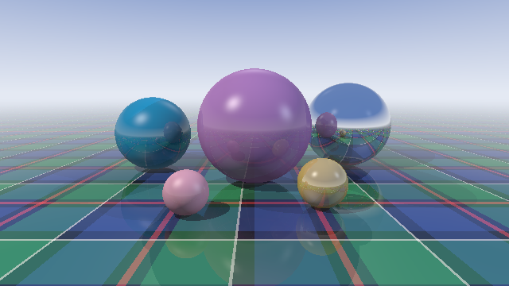

# Braw Rays - a ray tracer in mdhavers

A Whitted-style ray tracer written entirely in mdhavers: five spheres (a
thistle-purple one, a saltire-blue one, a mirror ball, gold and heather) on a
woven tartan floor, lit by three point lights. It does diffuse and Phong
specular shading, hard shadows, mirror reflections (three bounces), a little
distance haar (mist) and gamma correction. It uses `kin` classes for `Vec3`,
`Ray`, `Material` (with a `Tartan` subclass), `Sphere`, `Floor`, `Light`,
`Scene` and `Camera`. It is deterministic: no randomness.



## Running

```bash
# Interpreter: ASCII preview on stdout, 96x54 PPM written to raytracer.ppm
mdhavers run examples/showcases/raytracer/raytracer.braw

# Native (LLVM)
mdhavers build examples/showcases/raytracer/raytracer.braw -o braw_rays
RAYTRACE_SIZE=large RAYTRACE_OUT=braw_rays.ppm ./braw_rays
```

Settings come from environment variables, because `mdhavers run` does not pass
extra arguments to the program:

| Variable | Meaning | Default |
|---|---|---|
| `RAYTRACE_SIZE` | `small` (96x54), `medium` (320x180), `large` (640x360) or `WxH` | `small` |
| `RAYTRACE_OUT` | PPM (P3) output path | `raytracer.ppm` |
| `RAYTRACE_ASCII` | ASCII preview width in characters | `72` |
| `RAYTRACE_COLOUR` | `1` for a 24-bit ANSI colour preview | off |

`mdhavers run` changes into the script's directory, so a relative
`RAYTRACE_OUT` path lands next to the script. On macOS,
`sips -s format png raytracer.ppm --out raytracer.png` converts the output.

## Timings

Measured on Apple Silicon (macOS) on 2026-10-23. The interpreter was a
**debug** build of `mdhavers`; a release build is faster. The native binary
was built with `mdhavers build` (LLVM, `-O2`). Wall-clock times are for the
whole program, including the 72x20 ASCII preview.

| Scene | Interpreter | Native | Speed-up |
|---|---|---|---|
| small (96x54) | 7.9 s | 0.08 s | about 100x |
| medium (320x180) | 66.5 s | 0.80 s | about 80x |
| large (640x360) | not measured | 3.0 s | |

The native PPM is byte-identical to the interpreter's for both the small and
the medium scene. Every pixel goes through `floor` and `tae_int` before it is
written, so no float formatting reaches the file.

A cut-down copy of the engine is the golden test
`tests/golden/integration/showcase_raytracer_ascii.braw`.
